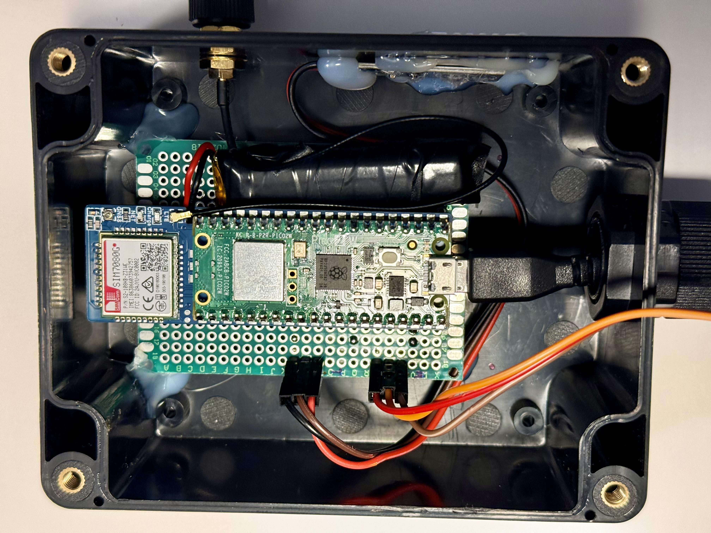
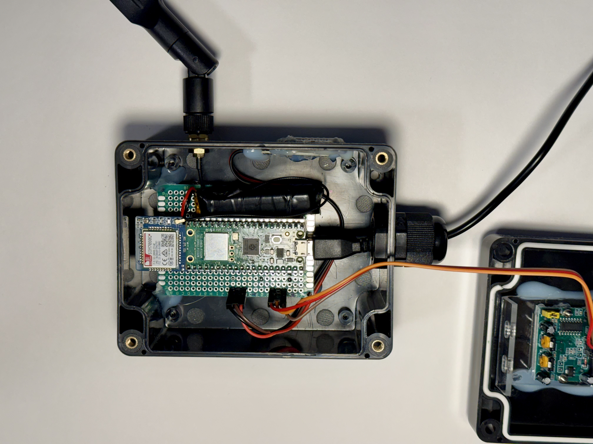
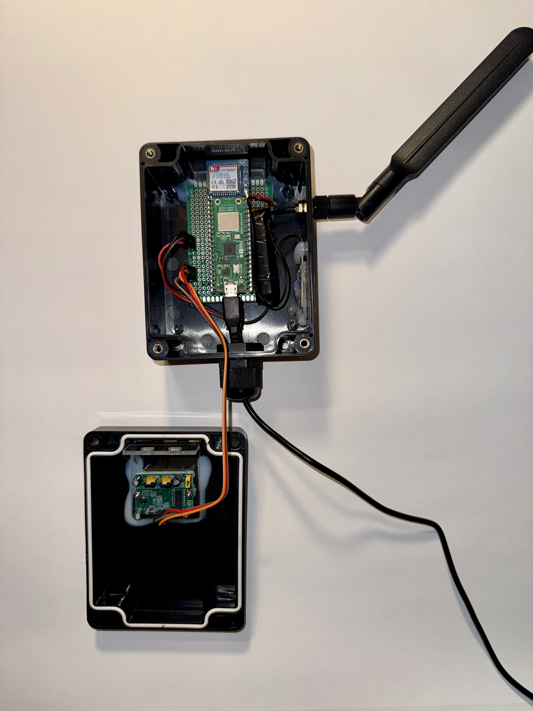
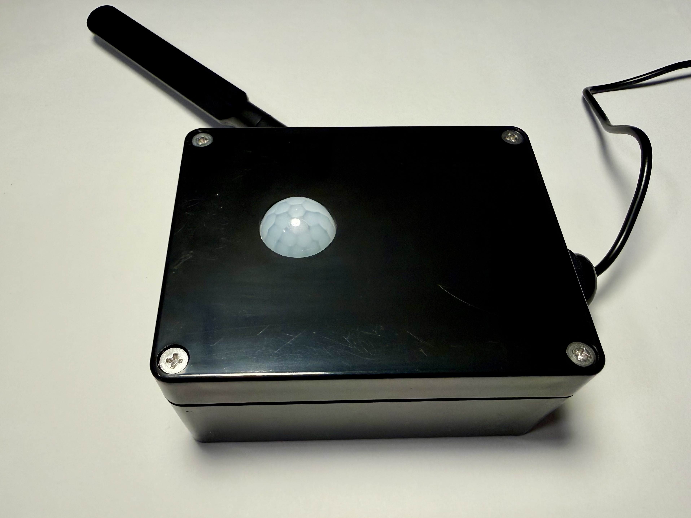

# 📡 Cellular IoT Remote Building Monitor

An ultra-low-power, standalone environmental and security monitoring system built for remote or off-grid locations. Powered by a **Raspberry Pi Pico 2 W** and a **SIM7080G LTE-M / NB-IoT cellular modem**, this system monitors ambient temperature, humidity, and physical intrusion, syncing securely to the Blynk IoT cloud.

---

## 🛠️ Hardware Stack
- **Microcontroller:** Raspberry Pi Pico 2 W (RP2040)
- **Cellular Module:** Waveshare SIM7080G Cat-M / NB-IoT HAT
- **Environmental Sensor:** DHT22 (Temperature & Relative Humidity)
- **Motion Sensor:** PIR Motion Detector
- **Network / Carrier:** Hologram IoT (LTE-M network)
- **Cloud Platform:** Blynk IoT (HTTP REST API over Port 80)

---

## ⚡ Key Engineering Features

- **Power-Optimized Cellular Duty Cycling:** The modem remains fully powered down during normal monitoring. It wakes up *only* on scheduled intervals, freeze warnings, or motion triggers, significantly extending field deployment life.
- **Smart Data-Saving Protocol:** 
  * Motion alerts and auto-clear triggers (`v3=1` / `v3=0`) use lightweight single-pin updates to minimize data overhead.
  * Full telemetry (temperature, humidity, and motion state) is batched and transmitted on a 3-hour scheduled heartbeat or immediate freeze warning ($\le 45^\circ\text{F}$).
- **Single-Session Motion Sequence:** When motion is detected, the system wakes the modem once, sends the intrusion alert, holds the live GPRS socket open for a 10-second window, sends the clear signal, and shuts down—cutting cellular session overhead in half.
- **Robust Network Recovery:** Implements explicit TCP socket cleanup (`client.stop()`), strict connection timeouts, and a 3-tier retry loop to gracefully handle marginal cellular signal drops.
- **Fail-Safe Operation:** 
  * Features a robust **2-hour software inactivity watchdog** using the RP2040 hardware watchdog library (`watchdog_reboot(0, 0, 0)`) to auto-recover from unexpected lockups.
  * Built-in DHT22 `NaN` resample routine (retries up to 3 times with a fallback reading of 99.0°F) to prevent sensor read faults from crashing program execution.

---

## 📌 Pinout Mapping

| Component | Pico Pin | Description |
| :--- | :--- | :--- |
| **SIM7080G TX** | GP0 (UART0 TX) | Serial communication to modem |
| **SIM7080G RX** | GP1 (UART0 RX) | Serial communication from modem |
| **SIM7080G PWRKEY** | GP14 | Hardware power control toggle |
| **DHT22 Data** | GP3 | Temperature and humidity signal |
| **PIR Motion Out** | GP2 | Digital motion trigger input |

---

## 📸 Hardware & Assembly Gallery

| Overview & Internal Layout | Close-Up Circuitry |
| :---: | :---: |
|  |

| Internal Components Top-Down | Fully Assembled Enclosure (Front) |
| :---: | :---: |
|  |  |

| Enclosure with Cellular Antenna |
| :---: |
|  |
